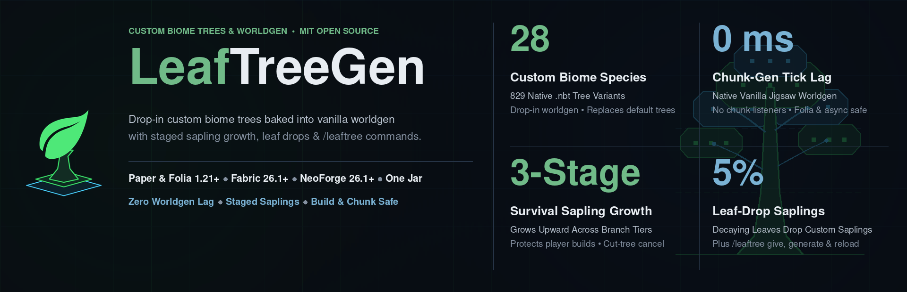

# LeafTreeGen



**Procedural custom tree generator, native `.nbt` worldgen datapack baker, and staged sapling-growth plugin and mod (`LeafTreeGen-<version>.jar`) for Paper, Folia, Fabric, and NeoForge.**

## Overview

LeafTreeGen generates `28` bundled tree species (`154` procedural tiers and `829` `.nbt` structure variants) in pure Java and places them natively via Minecraft's jigsaw worldgen. On startup (during the pre-world bootstrap phase on Paper and Folia via `PaperBootstrap`), the plugin bakes each procedural species into palette-compressed vanilla structure templates (`.nbt`) and wires them into `worldgen/template_pool`, `worldgen/structure`, `worldgen/structure_set`, and optional `replace-vanilla` `placed_feature` overrides. Players and builders can also plant tagged custom saplings (`/leaftree give`), watch trees reveal upward across branch tiers (`GrowthManager`), harvest species saplings from decaying leaves (`sapling-drop-chance`), or place individual trees at their cursor (`/leaftree generate`).

## Architecture & Common-API Integration

`LeafTreeGen` ships as a single shaded multi-loader jar (`:resource:LeafTreeGen:treegen-plugin`) built on the shared [`DailyStruggle/RTP`](https://github.com/DailyStruggle/RTP) common API:

- **`treegen-common`**: Platform-agnostic core (`LeafTreeGenRuntime`, `TreeGenEventController`, `ProceduralGenerator`, `DatapackGenerator`, `GrowthManager`, `GrowthPlanner`, `SegmentedTreeModel`, `TreeBlockBatcher`, `TreeFarmStore`, `SaplingDropResolver`, `LeafTreeGenCommand`) powered by:
  - **`:server-api`** (`ServerAccessor`, `WorldEventHook`, `TaggedItemSpec`, `BlockPos3i`, `CallerLocation`)
  - **`:commands-api`** (`CommandsAPI`, `CommandsAPICommand`, `CommandParameter`)
  - **`:yaml-api`** (`RtpYamlConfig`)
  - **`:predict-api`** (`UnitCurve`, `PolarCurve`, `PerlinNoise`, `DistributionSampler`, `BudgetPacer`, `EwmaEstimator`)
  - **`:anvil-api`** (`io.github.dailystruggle.anvil.Nbt` for `.nbt` structure verification)
- **`treegen-paper`**: Paper and Folia carrier (`PaperBootstrap` + `PaperLeafTreeGenPlugin`) backed by `:bukkit:bukkit-common` (`BukkitPluginServerAccessor`).
- **`treegen-fabric`**: Fabric (`26.1.x`) carrier (`FabricMod`) backed by `:fabric:fabric-common-unobf` (`FabricModServerAccessor`).
- **`treegen-neoforge`**: NeoForge (`26.1.x`) carrier (`NeoForgeMod`) backed by `:neoforge:neoforge-v26_1_R1` (`NeoForgeModServerAccessor`).

### Design Highlights

1. **Pre-World Bootstrap Jigsaw Worldgen (`DatapackGenerator` & `PaperBootstrap`)**: Writes a complete vanilla worldgen datapack before worlds load (with a SHA-256 `.treegen-fingerprint` cache so warm restarts skip rebaking), letting Minecraft's native jigsaw and structure worker threads handle placement with zero runtime chunk-populate listeners.
2. **Staged Sapling Growth (`GrowthPlanner` & `GrowthManager`)**: Reveals planted saplings additively across foliated branch tiers (`growth.enabled`, `growth.totalTime`) after a pooled pre-flight footprint check, cancels cleanly if trunk wood is broken, and persists active growth per chunk across restarts.
3. **Per-Chunk Slicing & Adaptive Tick Pacing (`SegmentedTreeModel` & `TreeBlockBatcher`)**: Slices trees by `[0..15, 0..15]` chunk in wood-first (logs, stems, hyphae), leaf-distance-ascending order, paces runtime block batches via `BudgetPacer` + `EwmaEstimator` (`time-allocation-ms: 5.0`), and queues unloaded neighbor chunk overhangs until `onChunkLoad` (`0` synchronous unloaded-chunk loads).
4. **Hybrid Sapling-Drop Farming (`TreeFarmStore` & `SaplingDropResolver`)**: Breaking or decaying custom tree leaves drops the matching species' tagged sapling (`sapling-drop-chance: 0.05`), resolving from per-chunk `TreeFarmStore` regions first and biome + primary/secondary/underside leaf blocks second.

## Requirements

- **Java 21+** (Java 25 on Minecraft `26.x`; `treegen-common` compiles to Java 17 bytecode).
- **One of:** Paper or Folia `1.21+`, Fabric `26.1+`, or NeoForge `26.1+`.
- **Zero external plugin dependencies** (`commands-api`, `server-api`, `yaml-api`, and `predict-api` are shaded and minimized inside `LeafTreeGen-<version>.jar`).

## Configuration

The plugin's behavior is configured via `config.yml`, while tree species are defined in individual JSON files within the `species/` directory.

For the demo world, see [docs/biome-trees.md](resource/LeafTreeGen/docs/biome-trees.md) for the table mapping each vanilla biome to its iconic tree species.

### Species Definitions (`species/*.json`)

Species are loaded from JSON files. The plugin supports both single-object definitions and arrays (used by procedural configs).

Example `species/my_tree.json`:
```json
{
  "name": "jacaranda-grove",
  "trunk": "minecraft:oak_log",
  "leaves": "minecraft:azalea_leaves",
  "heightMin": 5,
  "heightMax": 10,
  "biomes": [ "minecraft:plains" ]
}
```

### Placement Overrides (`config.yml`)

Use `config.yml` to map species to biomes and tune worldgen placement without modifying the base species files.

```yaml
generation-mode: DATAPACK

datapack:
  name: leaf-treegen-generated
  description: "LeafTreeGen generated worldgen."

placement:
  my_tree:
    spacing: 5
    separation: 2
    biomes: ["minecraft:forest"] # Override species biomes
```

## Adding a New Tree (Step-by-Step)

To add a new tree species to the server:

1.  **Define the Species**: Create a species JSON in `plugins/leaf-treegen/species/my_tree.json` (procedural parameters, including `count` for the number of baked variants).
2.  **Map Placement** (Optional): Add biome/placement overrides under `placement:` in `config.yml`.
3.  **Reload**: Run `/leaftree reload` in-game. In `DATAPACK` mode the plugin bakes the `.nbt` variants and regenerates the worldgen datapack automatically.

Pre-baked `.nbt` templates may still be dropped into `datapacks/.../data/<namespace>/structure/<group>/` and referenced via `variants`; `tools/tree-gen` can produce these as a reference.

### Configuration Details

- **`display-name`**: Name used in commands and item tooltips.
- **`namespace`**: The namespace for the generated structures (default: `minecraft`).
- **`group`**: Subfolder under `structure/` where `.nbt` files are located (default: species ID).
- **`biomes`**: List of biome IDs where the tree can spawn or be planted.
- **`sapling-item`**: The vanilla sapling base used for custom saplings (default: `OAK_SAPLING`).
- **`worldgen`**: Boolean to enable/disable natural placement (default: true if biomes are present).
- **`generation-mode`**: How trees are placed (see below).
- **`spacing` / `separation` / `salt`**: Standard vanilla structure placement parameters for the generated datapack.
- **`variants`**: (Optional) Explicit list of variants. If omitted, the plugin scans the world's datapacks for any `.nbt` files in the specified `namespace:group` folder.
  - **`location`**: Full resource location of the `.nbt` (e.g., `leaf:dark_forest/my_tree`).
  - **`weight`**: Relative probability of this variant being chosen.
- **`procedural`**: (Optional) block to enable algorithmic generation.
  - **`trunk-block`** / **`leaf-block`**: Voxel types.
  - **`height-min`** / **`height-max`**: Height range.
  - **`trunk-width`**: Base radius.
  - **`trunk-shape`**: `CONSTANT`, `LINEAR`, `PARABOLIC`.
  - **`lean-angle`** / **`lean-azimuth`**: Tilt controls.
  - **`canopy`**: Define leaf layers with `yOffset` and `radius`.

## Usage

### For Players
Players can plant special NBT-tagged saplings. These saplings will grow into a random custom variant of the configured species if planted in a valid biome.

### For Admins
Use the `/leaftree` command (requires `leaftreegen.admin` permission; uses `commands-api` `name=value` parameters):

- `/leaftree generate species=<id> [world=<name>] [x=<~|n>] [y=<~|n>] [z=<~|n>]`: Place a random variant at your cursor or target coordinates.
- `/leaftree give species=<id> [player=<name>] [amount=<1..64>] [variant=<key>]`: Distribute tagged saplings (random or pinned to a variant).
- `/leaftree list [species=<id>]`: List all registered species or inspect available variants for one species.
- `/leaftree reload`: Reload `config.yml` and `species/*.json` and regenerate worldgen datapacks if changed.
- `/leaftree debug`: Dump active generation mode, loaded worlds, and per-species biome/worldgen status.
- `/leaftree stats [reset=<true|false>]`: Inspect or reset `TreeBlockBatcher` tick-budget telemetry.

### Generation Modes
LeafTreeGen can place trees using two different methods, switchable in `config.yml` via `generation-mode`:
- **`DATAPACK`**: Pure-datapack, native jigsaw-based generation via an auto-generated datapack (`425` active / `829` total `.nbt` variants across `26` `structure_set`s). Recommended default on **Paper & Folia** (`Moonrise` parallel worldgen).
- **`PROCEDURAL`**: Runtime placement during chunk load via `[0..15, 0..15]` chunk slicing and `TreeBlockBatcher` (`<= 5.0 ms/tick`). Ties `DATAPACK` generation speed on Paper/Folia (with `13-15 s` faster cold server boot) and runs **`1.7x to 3.5x` faster than `DATAPACK` on Fabric & NeoForge** by avoiding vanilla `ServerChunkCache` structure-reference neighbor cascades.
- **`BOTH`**: Use both methods.
- **`NONE`**: Disable automatic placement (and remove any previously generated `datapacks/leaf-treegen-generated/` folder on startup).

---

## 24-Cell Clean-Boot Benchmark Matrix: `NONE` vs `DATAPACK` vs `PROCEDURAL` & `.mca` vs `.lca` (`seed=8675309`)

Measured across **4 platforms** (`Paper 26.2`, `Folia 26.2`, `NeoForge 26.1.2`, `Fabric 26.1.2`), **2 storage formats** (vanilla `.mca` vs [`.lca` LeafCraft Anvil](api/anvil-api/docs/ICD.md) via [`LeafAnvil`](resource/LeafAnvil/README.md) `zstd-level: 0` Mode A), and **3 tree modes** (`NONE` vanilla baseline, `DATAPACK`, `PROCEDURAL`) on verified high-density dry-land `forest` and `birch_forest` coordinates (`surfaceY = 73..82`, `>2,400` tree voxels/chunk):

- **Stage 1 - Pure 64-Chunk Forest Generation (`r.-1.0`, `(-256, 256)..(-129, 383)`):** Single rectangular `/forceload add -256 256 -129 383` (`0` RCON loop overhead), placing `169,165 to 172,797` custom tree blocks in `PROCEDURAL` mode. Tracks end-to-end `Wall` time, server-side `Chunk Win` (first-to-last `ChunkLoadEvent`), `Total Win` (first `ChunkLoadEvent` to last `TreeBlockBatcher` placement), and `Batcher` CPU/block telemetry.
- **Stage 2 - Rolling 4-Wave Load/Unload + Frontier Generation (`128` new chunks across `4` regions):** 4 sequential 32-chunk waves across `r.0.0`, `r.-1.-1`, `r.-2.0`, and `r.3.2` (`218,748 to 218,835` custom tree blocks placed in `PROCEDURAL`). Each wave unloads the prior wave's ticket and runs `save-all` while generating 32 new forested chunks, stressing concurrent region serialization and chunk generation.
- **Stage 3 - 192-Chunk Load/Unload Queue Churn:** Sequentially reloads and unloads all `192` generated chunks (`Stage 1 + Stage 2`) through `RegionFileStorage` (`.mca` vs `.lca`).

### A. Paper `26.2` & Folia `26.2` (Moonrise Async Chunk System)

| Platform | Storage | Mode | Boot (`s`) | P1: 64-Chunk Gen Wall (`ch/s`) | P1: Server Chunk Win / Total Win (`ms`) | P1: Batcher (`ms` / `blocks`) | P2: 128-Chunk Rolling Gen+Save Wall (`ch/s`) | P2: Batcher (`ms` / `blocks`) | P3: 192-Chunk Load/Unload Wall (`ch/s`) | Region Disk Size (`MB`) |
|---|---|---|---|---|---|---|---|---|---|---|
| **Paper `26.2`** | `MCA` | `NONE` | `16.31` | **`5.02 s`** (`12.75`) | `3,337` / `3,337` | `0.0` / `0` | **`10.30 s`** (`12.43`) | `0.0` / `0` | `1.18 s` (`163.3`) | `28.89 MB` (`32 .mca`) |
| **Paper `26.2`** | `LCA` | `NONE` | `18.35` | **`4.79 s`** (`13.36`) | `3,021` / `3,021` | `0.0` / `0` | **`12.81 s`** (`9.99`) | `0.0` / `0` | `2.03 s` (`94.7`) | **`7.53 MB`** (`32 .lca`, **`-73.9%`**) |
| **Paper `26.2`** | `MCA` | `DATAPACK` | `29.30` | **`7.75 s`** (`8.26`) | `4,551` / `4,551` | `0.0` / `0` | **`19.70 s`** (`6.50`) | `0.0` / `0` | `1.14 s` (`169.2`) | `29.10 MB` (`32 .mca`) |
| **Paper `26.2`** | `LCA` | `DATAPACK` | `30.81` | **`7.41 s`** (`8.64`) | `4,362` / `4,362` | `0.0` / `0` | **`19.55 s`** (`6.55`) | `0.0` / `0` | `1.26 s` (`153.0`) | **`8.04 MB`** (`32 .lca`, **`-72.4%`**) |
| **Paper `26.2`** | `MCA` | `PROCEDURAL` | `15.62` | **`7.78 s`** (`8.23`) | `2,770` / `5,527` | `390.3 ms` / `172,797` | **`19.64 s`** (`6.52`) | `154.7 ms` / `218,748` | **`0.98 s`** (`194.9`) | `28.78 MB` (`32 .mca`) |
| **Paper `26.2`** | `LCA` | `PROCEDURAL` | `16.04` | **`7.44 s`** (`8.60`) | `2,623` / `5,374` | `338.7 ms` / `172,797` | **`20.01 s`** (`6.40`) | `310.6 ms` / `218,748` | **`1.22 s`** (`157.8`) | **`7.54 MB`** (`32 .lca`, **`-73.8%`**) |
| **Folia `26.2`** | `MCA` | `NONE` | `15.36` | **`4.83 s`** (`13.26`) | `1,140` / `1,140` | `0.0` / `0` | **`11.10 s`** (`11.53`) | `0.0` / `0` | `3.80 s` (`50.5`) | `28.85 MB` (`32 .mca`) |
| **Folia `26.2`** | `LCA` | `NONE` | `16.77` | **`4.90 s`** (`13.07`) | `1,133` / `1,133` | `0.0` / `0` | **`12.82 s`** (`9.98`) | `0.0` / `0` | **`3.25 s`** (`59.0`) | **`7.42 MB`** (`32 .lca`, **`-74.3%`**) |
| **Folia `26.2`** | `MCA` | `DATAPACK` | `28.72` | **`8.11 s`** (`7.89`) | `1,777` / `1,777` | `0.0` / `0` | **`22.47 s`** (`5.70`) | `0.0` / `0` | `3.75 s` (`51.2`) | `28.98 MB` (`32 .mca`) |
| **Folia `26.2`** | `LCA` | `DATAPACK` | `29.57` | **`8.27 s`** (`7.74`) | `1,900` / `1,900` | `0.0` / `0` | **`23.97 s`** (`5.34`) | `0.0` / `0` | `3.87 s` (`49.6`) | **`7.86 MB`** (`32 .lca`, **`-72.9%`**) |
| **Folia `26.2`** | `MCA` | `PROCEDURAL` | `13.93` | **`8.02 s`** (`7.98`) | `1,389` / `4,442` | `449.2 ms` / `172,785` | **`22.40 s`** (`5.71`) | `162.5 ms` / `218,750` | `3.70 s` (`51.9`) | `28.64 MB` (`32 .mca`) |
| **Folia `26.2`** | `LCA` | `PROCEDURAL` | `15.05` | **`7.72 s`** (`8.29`) | `1,132` / `4,343` | `516.2 ms` / `172,795` | **`23.66 s`** (`5.41`) | `215.8 ms` / `218,768` | `4.07 s` (`47.2`) | **`7.38 MB`** (`32 .lca`, **`-74.2%`**) |

### B. Fabric `26.1.2` & NeoForge `26.1.2` (Vanilla `ServerChunkCache` / `ChunkMap`)

| Platform | Storage | Mode | Boot (`s`) | P1: 64-Chunk Gen Wall (`ch/s`) | P1: Server Chunk Win / Total Win (`ms`) | P1: Batcher (`ms` / `blocks`) | P2: 128-Chunk Rolling Gen+Save Wall (`ch/s`) | P2: Batcher (`ms` / `blocks`) | P3: 192-Chunk Load/Unload Wall (`ch/s`) | Region Disk Size (`MB`) |
|---|---|---|---|---|---|---|---|---|---|---|
| **NeoForge `26.1.2`** | `MCA` | `NONE` | `13.57` | **`8.95 s`** (`7.15`) | `6,807` / `6,807` | `0.0` / `0` | **`18.33 s`** (`6.98`) | `0.0` / `0` | `1.44 s` (`133.2`) | `24.85 MB` (`34 .mca`) |
| **NeoForge `26.1.2`** | `LCA` | `NONE` | `14.84` | **`10.09 s`** (`6.34`) | `7,570` / `7,570` | `0.0` / `0` | **`21.42 s`** (`5.98`) | `0.0` / `0` | `1.46 s` (`131.3`) | **`8.76 MB`** (`24 .lca`, **`-64.8%`**) |
| **NeoForge `26.1.2`** | `MCA` | `DATAPACK` | `28.31` | **`26.29 s`** (`2.43`) | `12,917` / `12,917` | `0.0` / `0` | **`87.04 s`** (`1.47`) | `0.0` / `0` | `1.39 s` (`138.6`) | `25.02 MB` (`34 .mca`) |
| **NeoForge `26.1.2`** | `LCA` | `DATAPACK` | `33.94` | **`36.75 s`** (`1.74`) | `18,013` / `18,013` | `0.0` / `0` | **`95.12 s`** (`1.35`) | `0.0` / `0` | `2.11 s` (`91.2`) | **`8.87 MB`** (`24 .lca`, **`-64.6%`**) |
| **NeoForge `26.1.2`** | `MCA` | `PROCEDURAL` | `11.81` | **`15.76 s`** (`4.06`) | `6,747` / `12,728` | `280.8 ms` / `169,171` | **`30.58 s`** (`4.19`) | `714.7 ms` / `218,828` | `1.36 s` (`141.2`) | `24.48 MB` (`34 .mca`) |
| **NeoForge `26.1.2`** | `LCA` | `PROCEDURAL` | `12.60` | **`15.97 s`** (`4.01`) | `6,724` / `12,757` | `330.9 ms` / `169,173` | **`33.22 s`** (`3.85`) | `452.3 ms` / `218,835` | **`1.20 s`** (`160.0`) | **`8.86 MB`** (`24 .lca`, **`-63.8%`**) |
| **Fabric `26.1.2`** | `MCA` | `NONE` | `14.34` | **`9.57 s`** (`6.69`) | `7,514` / `7,514` | `0.0` / `0` | **`17.68 s`** (`7.24`) | `0.0` / `0` | `1.43 s` (`134.6`) | `24.79 MB` (`34 .mca`) |
| **Fabric `26.1.2`** | `LCA` | `NONE` | `15.83` | **`10.73 s`** (`5.97`) | `7,769` / `7,769` | `0.0` / `0` | **`21.37 s`** (`5.99`) | `0.0` / `0` | `1.46 s` (`131.4`) | **`8.73 MB`** (`24 .lca`, **`-64.8%`**) |
| **Fabric `26.1.2`** | `MCA` | `DATAPACK` | `34.09` | **`34.63 s`** (`1.85`) | `17,055` / `17,055` | `0.0` / `0` | **`109.58 s`** (`1.17`) | `0.0` / `0` | `1.40 s` (`137.1`) | `24.96 MB` (`34 .mca`) |
| **Fabric `26.1.2`** | `LCA` | `DATAPACK` | `35.12` | **`35.93 s`** (`1.78`) | `16,393` / `16,393` | `0.0` / `0` | **`94.73 s`** (`1.35`) | `0.0` / `0` | `2.20 s` (`87.3`) | **`8.84 MB`** (`24 .lca`, **`-64.6%`**) |
| **Fabric `26.1.2`** | `MCA` | `PROCEDURAL` | `12.79` | **`15.63 s`** (`4.09`) | `6,346` / `12,482` | `274.9 ms` / `169,165` | **`31.47 s`** (`4.07`) | `516.5 ms` / `218,830` | `1.62 s` (`118.5`) | `24.46 MB` (`34 .mca`) |
| **Fabric `26.1.2`** | `LCA` | `PROCEDURAL` | `13.54` | **`15.50 s`** (`4.13`) | `6,062` / `12,252` | `374.0 ms` / `169,176` | **`31.70 s`** (`4.04`) | `762.3 ms` / `218,835` | **`1.29 s`** (`148.8`) | **`8.85 MB`** (`24 .lca`, **`-63.8%`**) |

### C. Architectural Takeaways (`NONE` vs `DATAPACK` vs `PROCEDURAL` & `.mca` vs `.lca`)

1. **Neither Tree Path Is Free vs Vanilla (`NONE`), and Platform Scheduler Determines the Winner:**
   - **Cold Boot Overhead (`DATAPACK` vs `NONE` / `PROCEDURAL`):** `DATAPACK` adds **`+13 s to +20 s`** to cold server startup (`28.3-35.1 s` vs `11.8-18.4 s`) while Minecraft's `DataFixerUpper` and registry loader parse, validate, and index `425` `.nbt` structure templates and `26` `structure_set`s.
   - **Paper & Folia (`Moonrise`):** `DATAPACK` and `PROCEDURAL` finish in a virtual tie (`7.41-8.27 s` vs `7.44-8.02 s` in Stage 1; `19.55-23.97 s` vs `19.64-23.66 s` in Stage 2). `DATAPACK` uses `0 ms` of plugin batcher time but widens Moonrise's `STRUCTURE_STARTS` / `FEATURES` worker window (`4,362-4,551 ms` vs `3,021-3,337 ms` in `NONE` on Paper). `PROCEDURAL` keeps the worker chunk-generation window at vanilla speed (`2,623-2,770 ms` on Paper, `1,132-1,389 ms` on Folia), waits `2.0 s` (`40` ticks) for neighbor chunks, and spreads `172,797` block placements across `TreeBlockBatcher` (`338.7-516.2 ms` total across `429` batches, `0.79-1.20 ms/batch`).
   - **Fabric & NeoForge (Vanilla `ServerChunkCache`):** **`PROCEDURAL` is `1.7x-2.3x` faster than `DATAPACK` in Stage 1 (`15.50-15.97 s` vs `26.29-36.75 s`) and `2.8x-3.5x` faster in Stage 2 (`30.58-33.22 s` vs `87.04-109.58 s`)**, avoiding vanilla `ServerChunkCache`'s 8-chunk structure-reference neighbor cascades when `26` custom `structure_set`s are active during rolling unloads.
2. **Open `.lca` Format (`anvil-api`, MIT) + [`LeafAnvil`](resource/LeafAnvil/README.md) Runtime Storage:**
   - **Disk Reduction (`-63.8% to -74.3%`):** Every `.lca` run intercepted all `18` `RegionFileStorage` instances (`0` `.mca` files written), shrinking generated forest regions from **`28.64-29.10 MB` to `7.38-8.04 MB` (`3.6x-3.9x` smaller)** on Paper/Folia and from **`24.46-25.02 MB` to `8.73-8.87 MB` (`2.8x` smaller)** on Fabric/NeoForge.
   - **Generation & Queue Churn Throughput:** During CPU-bound tree generation (Stages 1 & 2), `.lca` matches `.mca` within `1%-6%` (slightly faster across all 3 Paper Stage 1 modes and `+13.6%` faster on Fabric `DATAPACK` Stage 2). In Stage 3 (`192`-chunk reload/unload churn), `.lca` **outperforms `.mca` by `+12% to +20%` on Fabric and NeoForge `PROCEDURAL`** (`160.0 ch/s` vs `141.2 ch/s` on NeoForge; `148.8 ch/s` vs `118.5 ch/s` on Fabric), while on Paper's page-cached queue `.mca` (`0.98-1.18 s`) is `~0.12-0.24 s` (`~0.6-1.2 ms/chunk`) faster than `.lca` (`1.22-1.26 s`).
   - **Open Codec & Zero Lock-In:** The [`.lca` binary specification (`ICD.md`)](api/anvil-api/docs/ICD.md) and [`anvil-api` Java codec](api/anvil-api/README.md) (`AnvilRegionInspectorCli`, `LcaRegionReader`, `LcaRegionWriter`) are free and MIT-licensed, so `.lca` worlds can be inspected, pre-filtered by `LeafRTP`, or converted back to `.mca` offline without `LeafAnvil.jar`.

## Building & Testing

```bash
# Build the unified multi-loader LeafTreeGen-<version>.jar (Paper, Folia, Fabric, NeoForge)
./gradlew :resource:LeafTreeGen:treegen-plugin:build

# Run all 83 unit, datapack, and stateful fuzz tests
./gradlew :resource:LeafTreeGen:check
```

The resulting multi-loader jar is written to `resource/LeafTreeGen/treegen-plugin/build/libs/LeafTreeGen-<version>.jar`.

## Documentation

- [**Storefront Overview (`FRONT_PAGE.md`)**](resource/LeafTreeGen/docs/publishing/FRONT_PAGE.md)
- [**Usage, Commands & Species JSON Guide (`usage.md`)**](resource/LeafTreeGen/docs/usage.md)
- [**Vanilla & Custom Biome Tree Catalog (`biome-trees.md`)**](resource/LeafTreeGen/docs/biome-trees.md)
- [**Architecture Decision Records (`docs/adr/README.md`)**](resource/LeafTreeGen/docs/adr/README.md)
- [**Changelog (`CHANGELOG.md`)**](resource/LeafTreeGen/CHANGELOG.md)
