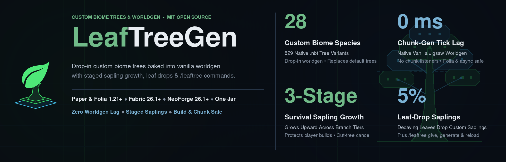
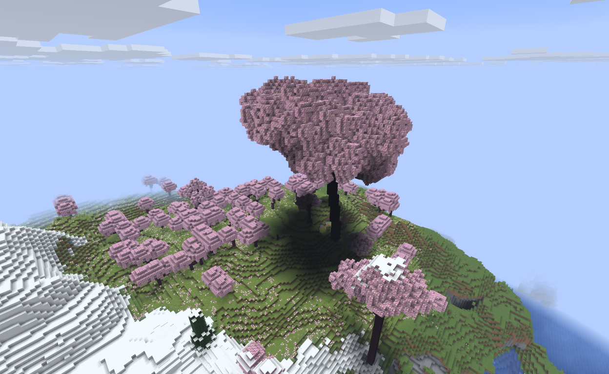
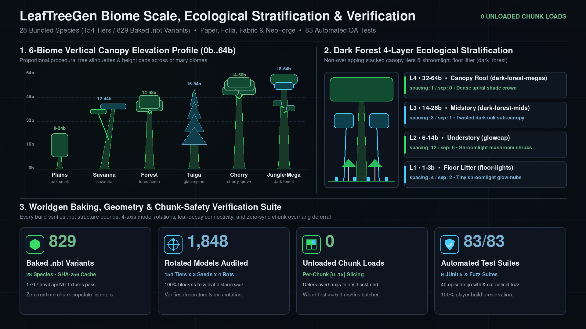
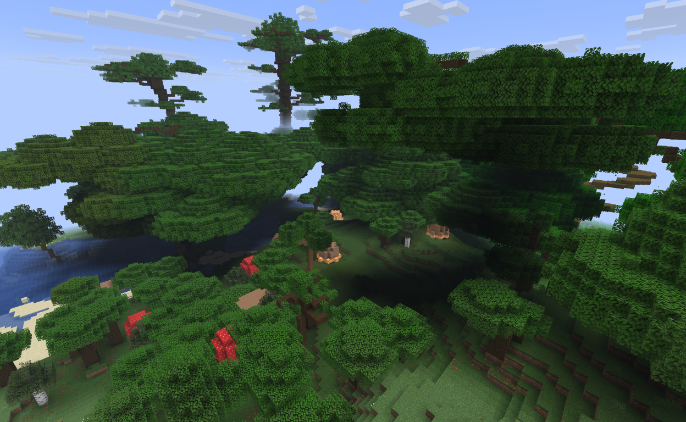
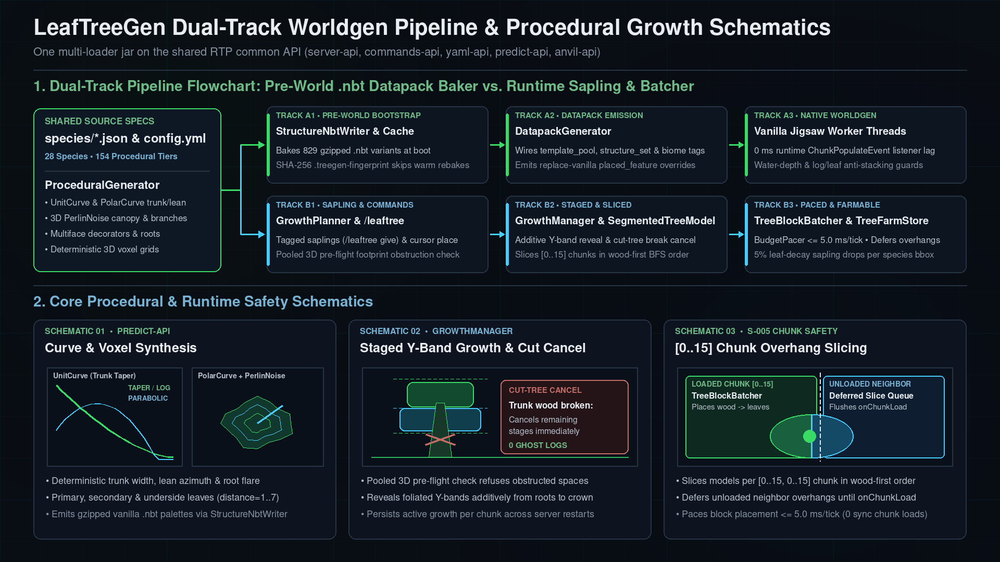

<!--
Single source for every LeafTreeGen storefront page (BuiltByBit, Modrinth, Hangar, SpigotMC).
Follows docs/dev/RULES.md Rule D-006 (first-person plain voice, 3-Zone hierarchy,
ASCII punctuation only, concrete numbers and honest caveats).
  BuiltByBit Card Title: "LeafTreeGen - Procedural Custom Trees & Native Worldgen Datapacks"
  BuiltByBit Card Thumbnail: docs/assets/leaftreegen-card-thumbnail.png
  BuiltByBit Carousel Slides: docs/assets/leaftreegen-action-showcase.webp, docs/assets/leaftreegen-card-thumbnail.png, docs/assets/leaftreegen-benchmark-comparison.png, docs/assets/leaftreegen-architecture-workflow.png, docs/images/cherry-grove-giant.png, docs/images/dark-forest-canopy.png
  Title: "LeafTreeGen"  tagline: "Procedural custom biome trees baked into vanilla worldgen datapacks, staged sapling growth & custom saplings for Paper, Folia, Fabric & NeoForge"
-->

<!-- not: bbb -->

<!-- /not -->

# {{name}}: Procedural Custom Trees, Native Worldgen Datapacks & Staged Sapling Growth

## Worldgen

**{{name}} is a procedural custom tree generator, native worldgen datapack baker, and staged sapling-growth plugin and mod for Paper, Folia, Fabric, and NeoForge.** Drop the jar into `plugins/` or `mods/` and start the server: it bakes `28` bundled tree species (`154` procedural size tiers and `829` `.nbt` structure variants) into standard vanilla `.nbt` structure templates and jigsaw template pools on startup, so Minecraft's own world generator places biome-matched custom trees during normal chunk creation without runtime block listeners. Players and builders can also plant custom saplings (`/leaftree give`), watch trees grow upward stage-by-stage, harvest matching saplings from decaying leaves, or place species at their cursor (`/leaftree generate`).

I originally wrote the procedural geometry engine for my own custom worlds, and rebuilt it in pure Java on the shared [`DailyStruggle/RTP`](https://github.com/DailyStruggle/RTP) common API (`server-api`, `commands-api`, `yaml-api`, `predict-api`, and `anvil-api`) so one jar runs across Paper, Folia, Fabric, and NeoForge.

<!-- not: bbb -->

*A Cherry Grove Giant generated from procedural species parameters and placed through native jigsaw worldgen.*
<!-- /not -->

### The short version

**Bakes `28` procedural tree species (`829` `.nbt` variants) into native vanilla jigsaw worldgen datapacks at startup, with staged sapling growth, leaf-drop farming, and one multi-loader jar for Paper, Folia, Fabric, and NeoForge.**

- [**Easy**](#install): drop `{{jar}}` into `plugins/` or `mods/` to generate the worldgen datapack automatically before worlds load, or run `/leaftree reload` after editing a species JSON file.
- [**Safe**](#how-it-works): native datapack mode uses vanilla jigsaw structure placement with zero runtime chunk-populate block listeners, while runtime sapling growth checks build footprints and defers unloaded neighbor chunk overhangs.
- [**Biome-matched**](../biome-trees.md): ships with `28` curated species (`154` tiers) across temperate forests, cherry and jacaranda groves, savanna acacias, glacier pines, swamps, and 3-layer dark-forest canopies.
- [**Staged growth**](#features): planted saplings can grow incrementally from the base upward across branch tiers, cancelling cleanly if chopped down and dropping species-tagged saplings when leaves decay.
- [**One jar**](../../README.md): runs the same procedural engine, worldgen datapack baker, and `/leaftree` commands on Paper, Folia, Fabric, and NeoForge (`1.21+` to `26.x`).

<b>More highlights</b>

- [**First-boot Paper & Folia bootstrap (`PaperBootstrap`)**](#how-it-works): writes the worldgen datapack during the pre-world bootstrap phase before Minecraft discovers datapacks, and caches a SHA-256 fingerprint (`.treegen-fingerprint`) so subsequent restarts skip redundant `.nbt` rebaking.
- [**Vanilla tree replacement & water/stacking guards (`replace-vanilla: true`)**](#features): suppresses default biome trees via datapack `placed_feature` overrides, rejects accidental ocean/river placements (`surface_water_depth_filter`), and prevents stacking trees on top of existing `#minecraft:logs` or `#minecraft:leaves`.
- [**Survival leaf-drop sapling farming (`sapling-drop-chance`)**](#how-it-works): breaking or decaying custom tree leaves drops that species' tagged sapling, tracked per chunk via `TreeFarmStore` bounding boxes with biome + primary/secondary/underside leaf fallback.
- [**Pre-baked `.nbt` template discovery**](#how-it-works): automatically discovers any hand-built `.nbt` structure files dropped into your world datapacks alongside procedural species.

Species tables and biome mappings are in [Performance](#performance) and [`biome-trees.md`](../biome-trees.md).

## Common setups

These work out of the box from `config.yml`:

- [**Native datapack worldgen (`generation-mode: DATAPACK`, default on Paper & Folia)**](#install): Generates a complete vanilla worldgen datapack (`829` `.nbt` variants across `28` species) on startup so Moonrise worker threads place biome-matched custom trees during normal chunk creation with zero plugin block-batcher work.
- [**Paced procedural worldgen (`generation-mode: PROCEDURAL`, recommended on Fabric & NeoForge)**](#performance): Keeps server startup at vanilla speed (`11.8-16.0 s`) and places custom trees through `TreeBlockBatcher` as chunks load, running `1.7x to 3.5x` faster than jigsaw datapacks on Fabric and NeoForge by avoiding vanilla `ServerChunkCache` structure-reference neighbor cascades.
- [**Survival custom saplings & staged tree farming**](#features): Distribute biome-specific saplings (`/leaftree give species=jacaranda-grove player=Alice amount=4`) that grow stage-by-stage and drop replantable custom saplings when their leaves decay (`sapling-drop-chance: 0.05`).
- [**Paired with open `.lca` storage (`LeafAnvil`) and `LeafRTP`**](../../README.md): Custom-tree forests add `~391,500` log, leaf, and decorator blocks per `192` chunks; storing worlds in the open MIT [`.lca` format (`anvil-api`)](../../../../api/anvil-api/README.md) via [`LeafAnvil`](../../../LeafAnvil/docs/publishing/FRONT_PAGE.md) shrinks those forest region files by `63.8% to 74.3%` (`28.8 MB -> 7.5 MB` on Paper/Folia) with no generation slowdown, while [`LeafRTP`](../../../LeafRTP/docs/publishing/FRONT_PAGE.md) reads `.mca`, `.linear`, and `.lca` regions directly.

---

## Install

**Requirements:** Paper or Folia 1.21+, or Fabric / NeoForge 26.1+. Java 21+ (Java 25 on 26.x).

1. Drop `{{jar}}` into `plugins/` (Paper, Folia) or `mods/` (Fabric, NeoForge) and start the server.
2. In `DATAPACK` mode (default), `{{name}}` bakes the configured species into `.nbt` variants and writes `datapacks/leaf-treegen-generated/` automatically (during pre-world bootstrap on Paper and Folia so custom trees appear on the first boot).
3. **Optional - test or customize species:** Run `/leaftree list`, `/leaftree generate species=cherry-grove`, or `/leaftree give species=cherry-grove` in-game, or edit `config.yml` and `species/*.json` and run `/leaftree reload`.

---

## Features

- **28 bundled species (`154` tiers, `829` baked `.nbt` variants):** ships with temperate oaks, old-growth birches, maple-birch giants, cherry and jacaranda groves, savanna acacias, glacier pines, festive spruce landmarks, weeping swamp mangroves, 3-layer dark-forest titans, and glowing mushroom understories ([full biome map](../biome-trees.md)).
- **Pure-Java procedural voxel baker:** computes trunks (`CONSTANT`, `LINEAR`, `PARABOLIC`, `EXPONENTIAL`, `SINUSOIDAL`, `HARMONIC`, `STEPPED`, `TAPER`, `LOG`), lean angles, root buttresses, lateral branches, sub-branches, weighted `secondary_leaves`, canopy `start_angle` and vertical `squish`, and multiface decorators (`glow_lichen`, `vine`, `sculk_vein`, `resin_clump`, `pointed_dripstone`) directly into compressed vanilla `.nbt` structure files.
- **Native jigsaw pools & vanilla tree replacement:** wires generated `.nbt` variants and high-density `feature-trees` into `worldgen/template_pool`, `worldgen/structure`, `worldgen/structure_set`, and `placed_feature` suppression overrides with water-depth and anti-tree-stacking predicates.
- **Staged sapling growth & player-build protection:** planted saplings can reveal additively across branch tiers (`growth.enabled`, `growth.totalTime`) after a pooled pre-flight footprint check, stopping cleanly on mid-growth obstructions and cancelling remaining stages if chopped down.
- **Hybrid leaf-drop sapling farming:** decaying or broken custom tree leaves drop matching tagged saplings (`sapling-drop-chance: 0.05`), resolved from per-chunk `TreeFarmStore` bounding boxes first and biome + leaf block type second.
- **Per-chunk slicing & adaptive tick pacing:** slices runtime placements by chunk (`[0..15, 0..15]`) in wood-first, leaf-distance-ascending order, defers unloaded neighbor overhangs until `onChunkLoad`, and paces block batches within `time-allocation-ms` (`5.0 ms`) and `max-blocks-per-tick` (`1000`).
- **Cross-platform `/leaftree` command tree:** `/leaftree <generate|give|list|reload|debug|stats>` powered by `commands-api` with live species, variant, and online-player tab completion across Paper, Folia, Fabric, and NeoForge.

---

## Performance

Placing `~391,500` custom tree blocks across `192` forested chunks (`172,797` blocks in `64` chunks during Stage 1; `218,748` blocks in `128` rolling chunks across `4` regions during Stage 2) is not free compared to vanilla terrain (`NONE`). To give server owners an honest picture of both generation engines and world storage formats, we ran a clean-boot **24-cell benchmark matrix (`4 platforms x 2 storage formats [.mca, .lca] x 3 modes [NONE, DATAPACK, PROCEDURAL]`)** on verified dry-land `forest` and `birch_forest` continents (`seed=8675309`, `surfaceY=73..82`, `>2,400` tree voxels/chunk; [full 24-row breakdown in `README.md`](../../README.md)):

- **Paper & Folia (`Moonrise` parallel worldgen) - `DATAPACK` and `PROCEDURAL` tie on generation speed:**
  - In Stage 1 (`64` chunks), vanilla (`NONE`) finishes in `4.79 to 5.02 s`, while `DATAPACK` (`7.41 to 8.27 s`) and `PROCEDURAL` (`7.44 to 8.02 s`) both add `+2.6 to 3.3 s` (`+54% to +68%`). In Stage 2 (`128` rolling chunks + `save-all`), `DATAPACK` (`19.55 to 23.97 s`) and `PROCEDURAL` (`19.64 to 23.66 s`) finish within `1% to 2%` of each other.
  - **Why they tie through different paths:** `DATAPACK` spends `0.00 ms` on the plugin batcher, but evaluating `26` custom jigsaw `structure_set`s widens Moonrise's worker chunk-generation window (`4,362 to 4,551 ms` vs `3,021 to 3,337 ms` in `NONE` on Paper) and adds `+13 to +15 s` to cold server boot (`28.7 to 30.8 s` vs `13.9 to 18.4 s`) while Minecraft indexes `425` `.nbt` templates. `PROCEDURAL` boots at vanilla speed, keeps the underlying chunk-generation window at vanilla speed (`2,623 to 2,770 ms` on Paper; `1,132 to 1,389 ms` on Folia), waits `2.0 s` (`40` ticks) for neighbor chunks, and spreads `172,797` block placements smoothly across `TreeBlockBatcher` (`338.7 to 516.2 ms` total across `429` batches, `0.79 to 1.20 ms/batch`).
- **Fabric & NeoForge (vanilla `ServerChunkCache`) - `PROCEDURAL` is `1.7x to 3.5x` faster than `DATAPACK`:**
  - Without Moonrise's parallel structure scheduler, `26` custom jigsaw `structure_set`s trigger 8-chunk structure-reference neighbor cascades in vanilla `ServerChunkCache` during rolling unloads. `PROCEDURAL` completes Stage 1 in `15.50 to 15.97 s` vs `26.29 to 36.75 s` for `DATAPACK` (`1.7x to 2.3x` faster), and completes Stage 2 (`128` rolling chunks) in `30.58 to 33.22 s` vs `87.04 to 109.58 s` for `DATAPACK` (`2.8x to 3.5x` faster) while cutting cold boot time in half (`11.8 to 13.5 s` vs `28.3 to 35.1 s`).
- **Vanilla `.mca` vs Open `.lca` (`anvil-api` MIT codec + [`LeafAnvil`](../../../LeafAnvil/docs/publishing/FRONT_PAGE.md) runtime plugin/mod):**
  - Custom tree canopies (`28` species, multi-block log/leaf/decorator palettes) inflate vanilla `.mca` region files. Pairing `LeafTreeGen` with `.lca` (`zstd-level: 0` Mode A) shrinks generated forest region files by **`63.8% to 74.3%` (`2.8x to 3.9x` smaller: `28.6-29.1 MB -> 7.4-8.0 MB` across `32` regions on Paper/Folia; `24.5-25.0 MB -> 8.7-8.9 MB` on Fabric/NeoForge)**.
  - During CPU-bound generation (Stages 1 & 2), `.lca` matches `.mca` within `1% to 6%` (`7.41 s` vs `7.75 s` `DATAPACK` and `7.44 s` vs `7.78 s` `PROCEDURAL` on Paper Stage 1; `13.6%` faster on Fabric `DATAPACK` Stage 2 at `94.73 s` vs `109.58 s`). In Stage 3 (`192`-chunk reload/unload churn), `.lca` is **`+12% to +20%` faster** than `.mca` on Fabric and NeoForge `PROCEDURAL` (`1.20 s` / `160.0 ch/s` vs `1.36 s` / `141.2 ch/s` on NeoForge; `1.29 s` / `148.8 ch/s` vs `1.62 s` / `118.5 ch/s` on Fabric), while on Paper's page-cached Moonrise queue `.mca` is `0.98-1.18 s` vs `.lca` `1.22-1.26 s` (`~1 ms/chunk` difference). Because the [`.lca` spec (`ICD.md`)](../../../../api/anvil-api/docs/ICD.md) and [`anvil-api` Java codec](../../../../api/anvil-api/README.md) are free and MIT-licensed, `.lca` worlds can be inspected (`AnvilRegionInspectorCli`), pre-filtered by `LeafRTP`, or converted back to `.mca` offline without vendor lock-in.

<!-- not: bbb -->

<!-- /not -->

**24-Cell Clean-Boot Matrix Summary (`seed=8675309`, `64`-Chunk Gen + `128`-Chunk Rolling Gen + `192`-Chunk Reload Churn, `.mca` vs `.lca`):**

| Platform & Mode | Cold Boot (`.mca` / `.lca`) | Stage 1: `64`-Chunk Forest Gen Wall (`.mca` / `.lca`) | Stage 1: Server Chunk Win & `TreeBlockBatcher` | Stage 2: `128`-Chunk Rolling Gen+Save (`.mca` / `.lca`) | Stage 3: `192`-Chunk Load/Unload (`.mca` / `.lca`) | Region Disk Size (`.mca` vs `.lca`) |
|---|---|---|---|---|---|---|
| **Paper `26.2` - `NONE` (Vanilla)** | `16.3 s` / `18.4 s` | `5.02 s` / **`4.79 s`** (`13.4 ch/s`) | `3,337` / `3,021 ms` win; `0 ms` (`0` blocks) | `10.30 s` / `12.81 s` | `1.18 s` / `2.03 s` | `28.89 MB` vs **`7.53 MB` (`-73.9%`)** |
| **Paper `26.2` - `DATAPACK`** | `29.3 s` / `30.8 s` | `7.75 s` / **`7.41 s`** (`8.6 ch/s`) | `4,551` / `4,362 ms` win; `0 ms` (`0` blocks) | `19.70 s` / **`19.55 s`** | `1.14 s` / `1.26 s` | `29.10 MB` vs **`8.04 MB` (`-72.4%`)** |
| **Paper `26.2` - `PROCEDURAL`** | **`15.6 s` / `16.0 s`** | `7.78 s` / **`7.44 s`** (`8.6 ch/s`) | **`2,770` / `2,623 ms` win**; `339-390 ms` (`172,797` blocks) | `19.64 s` / `20.01 s` (`218,748` blocks) | **`0.98 s`** / `1.22 s` (`194.9` / `157.8 ch/s`) | `28.78 MB` vs **`7.54 MB` (`-73.8%`)** |
| **Folia `26.2` - `NONE` (Vanilla)** | `15.4 s` / `16.8 s` | **`4.83 s`** / `4.90 s` (`13.3 ch/s`) | `1,140` / `1,133 ms` win; `0 ms` (`0` blocks) | `11.10 s` / `12.82 s` | `3.80 s` / **`3.25 s`** | `28.85 MB` vs **`7.42 MB` (`-74.3%`)** |
| **Folia `26.2` - `DATAPACK`** | `28.7 s` / `29.6 s` | `8.11 s` / `8.27 s` (`7.9 ch/s`) | `1,777` / `1,900 ms` win; `0 ms` (`0` blocks) | `22.47 s` / `23.97 s` | `3.75 s` / `3.87 s` | `28.98 MB` vs **`7.86 MB` (`-72.9%`)** |
| **Folia `26.2` - `PROCEDURAL`** | **`13.9 s` / `15.1 s`** | `8.02 s` / **`7.72 s`** (`8.3 ch/s`) | **`1,389` / `1,132 ms` win**; `449-516 ms` (`172,795` blocks) | `22.40 s` / `23.66 s` (`218,768` blocks) | `3.70 s` / `4.07 s` | `28.64 MB` vs **`7.38 MB` (`-74.2%`)** |
| **NeoForge `26.1.2` - `NONE` (Vanilla)** | `13.6 s` / `14.8 s` | `8.95 s` / `10.09 s` (`7.2 ch/s`) | `6,807` / `7,570 ms` win; `0 ms` (`0` blocks) | `18.33 s` / `21.42 s` | `1.44 s` / `1.46 s` | `24.85 MB` vs **`8.76 MB` (`-64.8%`)** |
| **NeoForge `26.1.2` - `DATAPACK`** | `28.3 s` / `33.9 s` | `26.29 s` / `36.75 s` (`2.4 ch/s`) | `12,917` / `18,013 ms` win; `0 ms` (`0` blocks) | `87.04 s` / `95.12 s` | `1.39 s` / `2.11 s` | `25.02 MB` vs **`8.87 MB` (`-64.6%`)** |
| **NeoForge `26.1.2` - `PROCEDURAL`** | **`11.8 s` / `12.6 s`** | **`15.76 s` / `15.97 s`** (`4.1 ch/s`, **`1.7-2.3x` vs DP**) | **`6,747` / `6,724 ms` win**; `281-331 ms` (`169,173` blocks) | **`30.58 s` / `33.22 s`** (**`2.8x` vs DP**) | `1.36 s` / **`1.20 s` (`160.0 ch/s`, `+13%`)** | `24.48 MB` vs **`8.86 MB` (`-63.8%`)** |
| **Fabric `26.1.2` - `NONE` (Vanilla)** | `14.3 s` / `15.8 s` | `9.57 s` / `10.73 s` (`6.7 ch/s`) | `7,514` / `7,769 ms` win; `0 ms` (`0` blocks) | `17.68 s` / `21.37 s` | `1.43 s` / `1.46 s` | `24.79 MB` vs **`8.73 MB` (`-64.8%`)** |
| **Fabric `26.1.2` - `DATAPACK`** | `34.1 s` / `35.1 s` | `34.63 s` / `35.93 s` (`1.9 ch/s`) | `17,055` / `16,393 ms` win; `0 ms` (`0` blocks) | `109.58 s` / **`94.73 s`** (`+13.6%` `.lca`) | `1.40 s` / `2.20 s` | `24.96 MB` vs **`8.84 MB` (`-64.6%`)** |
| **Fabric `26.1.2` - `PROCEDURAL`** | **`12.8 s` / `13.5 s`** | **`15.63 s` / `15.50 s`** (`4.1 ch/s`, **`2.2-2.3x` vs DP**) | **`6,346` / `6,062 ms` win**; `275-374 ms` (`169,176` blocks) | **`31.47 s` / `31.70 s`** (**`3.0-3.5x` vs DP**) | `1.62 s` / **`1.29 s` (`148.8 ch/s`, `+20%`)** | `24.46 MB` vs **`8.85 MB` (`-63.8%`)** |

<!-- not: bbb -->

*Dense overlapping dark-forest canopies and giant mushrooms generated via jigsaw template pools.*
<!-- /not -->

---

## How it works

All procedural variant baking, jigsaw pool wiring, staged sapling reveals, and biome radius checks run automatically in the background behind standard `CIRCLE` canopy radii and biome lists in `config.yml`:

- **Procedural voxel synthesis (`predict-api`):** For each species JSON, `ProceduralGenerator` samples deterministic height, trunk taper (`UnitCurve`), lean azimuth (`PolarCurve`), 3D `PerlinNoise` / `NOISE` shaping, root flare, lateral branches, and weighted primary/secondary/underside leaf layers to produce `count` distinct 3D voxel grids.
- **Palette-compressed `.nbt` serialization & jigsaw emission:** `StructureNbtWriter` writes each voxel grid as a gzipped vanilla `.nbt` structure template, and `DatapackGenerator` emits `pack.mcmeta`, `#has_structure` biome tags, `template_pool` weights (`[1..150]` normalized via `DistributionSampler`), `structure_set` placement rules, and optional `replace-vanilla` `placed_feature` overrides.
- **Additive staged sapling growth (`GrowthPlanner` & `GrowthManager`):** When staged growth is enabled for a species, `GrowthPlanner` derives foliated Y-band stages from branch attach-heights (or even thirds for branchless models), checks the full 3D footprint in a pooled coordinate buffer before starting, and persists active growth state per chunk across restarts.
- **Chunk-sliced placement & hybrid sapling drops (`ServerAccessor` & `WorldEventHook`):** Built on the shared `server-api` and platform carriers (`bukkit-common`, `fabric-common-unobf`, `neoforge-v26_1_R1`), `TreeGenEventController` places loaded chunk slices via `TreeBlockBatcher`, queues overhangs for unloaded neighbor chunks until `onChunkLoad`, and resolves leaf-break sapling drops via `TreeFarmStore` and `SaplingDropResolver`.

### Dual-track worldgen pipeline and procedural growth schematics

<!-- not: bbb -->

<!-- /not -->

Each species definition (`species/*.json` and `config.yml`) feeds a dual-track worldgen and survival sapling pipeline:
- **Track A - Pre-world native `.nbt` datapack baker (`DATAPACK` mode):** `PaperBootstrap` and `DatapackGenerator` run before the server scans world `datapacks/` folders, baking `829` gzipped `.nbt` variants (`SHA-256` cached via `.treegen-fingerprint`) and wiring `template_pool`, `structure_set`, and `replace-vanilla` overrides so new chunks populate off-thread with zero runtime listeners.
- **Track B - Runtime staged sapling growth & `[0..15]` chunk overhang slicer:** Planted custom saplings (`/leaftree give`) and `/leaftree generate` validate a pooled 3D `isReplaceable` footprint, reveal foliated Y-band stages additively from roots to crown (cancelling cleanly if the trunk is chopped down), slice block batches per `[0..15, 0..15]` chunk (`<= 5.0 ms/tick`), and defer unloaded neighbor chunk overhangs until `onChunkLoad`.

---

## Testing and quality gates

Every build runs `89` automated JUnit 5, `anvil-api` NBT, and stateful fuzz tests across `10` verification suites before release:
- [**Worldgen datapack, `leaf:*` biome & `anvil-api` `.nbt` verification**](../biome-trees.md): `LeafWorldgenDatapackTest` and `StructureNbtWriterTest` verify `pack.mcmeta`, biome tag referential integrity, rainbow/maple foliage color parity, and gzipped `.nbt` palette/block bounds via `io.github.dailystruggle.anvil.Nbt`.
- [**1,848-model rotation, leaf-decay & extreme-parameter fuzz suite**](../adr/treegen-ADR-002-tree-configuration-and-outcomes.md): `TreeGenFuzzTest` and `TreeGenTest` build and rotate all `154` procedural definitions across `3` seeds and `4` rotations (`1,848` models) plus `100` extreme random parameter sets, verifying valid block-state properties, orthogonal wood-to-leaf connectivity (`distance=1..7`), and `100%` chunk-slice conservation.
- [**Staged growth, cut-tree cancellation & 40-episode lifecycle fuzzing**](../adr/treegen-ADR-001-tree-growth-mechanic.md): `GrowthManagerTest`, `GrowthPlannerTest`, and `TreeGenFuzzTest` verify additive Y-band stage derivation, pooled pre-flight obstruction refusal, mid-growth player-build protection, cut-tree cancellation, and corrupt chunk-record purging.
- [**Deferred chunk overhang, sapling-drop & command fuzzing**](../adr/treegen-ADR-003-java-plugin-architecture.md): `LeafTreeGenCommandTest`, `TreeGenEventControllerTest`, `SaplingDropResolverTest`, and `TreeFarmStoreTest` verify synchronous sapling consumption with failure refunds, unloaded neighbor overhang deferral until `onChunkLoad`, group-species leaf drops, and `/leaftree` `commands-api` dispatch, tab completion, and clickable chip execution.

---

## Why I made it

Most custom tree plugins hook into `ChunkPopulateEvent` or `StructureGrowEvent` and place thousands of blocks on the main server thread while players explore, causing lag spikes on survival servers and breaking on Folia. Pre-painted static maps avoid runtime listeners, but lose normal vanilla worldgen, structures, and new biomes.

I built `{{name}}` so server admins can define tree geometry in a small JSON file, bake `.nbt` variants in pure Java at startup, and let vanilla jigsaw worldgen place them off-thread as chunks generate - while using those same procedural models for staged survival sapling growth, leaf-drop tree farming, and `/leaftree generate` builder tools across Paper, Folia, Fabric, and NeoForge.

---

## Commands, configuration, and FAQ

Everyday commands, permissions, configuration keys, common operator questions, and support channels:

<b>Commands, permissions, configuration files</b>

**Operational commands** (root command: `/leaftree`; uses `commands-api` `name=value` syntax; full guide in [`usage.md`](../usage.md)):

| Command | Description | Permission |
| --- | --- | --- |
| `/leaftree generate species=<id> [world=<name>] [x=<~\|n>] [y=<~\|n>] [z=<~\|n>]` | Place a random variant of `<id>` at your cursor or target coordinates | `leaftreegen.admin` |
| `/leaftree give species=<id> [player=<name>] [amount=<1..64>] [variant=<key>]` | Give tagged custom saplings (random or pinned to a specific variant) to a player | `leaftreegen.admin` |
| `/leaftree list [species=<id>]` | List all registered tree species or inspect available variants for one species | `leaftreegen.admin` |
| `/leaftree reload` | Reload `config.yml` and `species/*.json` and rebake the worldgen datapack if changed | `leaftreegen.admin` |
| `/leaftree debug` | Display active `generation-mode`, loaded worlds, and per-species biome/worldgen status | `leaftreegen.admin` |
| `/leaftree stats [reset=<true\|false>]` | Show or reset `TreeBlockBatcher` tick-budget telemetry (blocks placed, batches, avg ms) | `leaftreegen.admin` |

**Permissions** (`paper-plugin.yml` / Brigadier):

| Permission | Default | Grants |
| --- | --- | --- |
| `leaftreegen.admin` | `op` (level 4) | Access to `/leaftree generate`, `give`, `list`, `reload`, `debug`, and `stats` |
| `leaftreegen.sapling` | `true` | Allows players to plant custom tagged tree saplings in survival/adventure |

**Configuration (`plugins/leaf-treegen/config.yml` or `config/leaf-treegen/config.yml` & `species/*.json`):**

| File / Key | Default | Purpose |
| --- | --- | --- |
| `generation-mode` | `DATAPACK` | Placement mode: `DATAPACK` (Paper/Folia default), `PROCEDURAL` (fastest on Fabric/NeoForge), `BOTH`, or `NONE` |
| `datapack.name` / `datapack.generate` | `leaf-treegen-generated` / `true` | Folder name and master toggle for the auto-generated worldgen datapack |
| `time-allocation-ms` / `max-blocks-per-tick` | `5.0` / `1000` | Per-tick time budget (ms) and block cap for `TreeBlockBatcher` runtime placement |
| `sapling-drop-chance` | `0.05` | Probability (`0.0..1.0`) that a broken or decaying custom leaf drops its tagged sapling |
| `water-growth-trees` | `[swamp]` | Species IDs allowed to take root on or in water (all others require dry solid ground) |
| `placement.<species>.replace-vanilla` | `true` (primary biomes) | Emit `placed_feature` overrides and intercept vanilla saplings in matching biomes |
| `placement.<species>.spacing` / `separation` | Species default | Average and minimum chunk distance between structure placement attempts |
| `placement.<species>.biomes` | Species default | Biome IDs (vanilla `minecraft:*` or custom `leaf:*`) where the species spawns |
| `species/<id>.json` | `28` bundled files | Per-species procedural trunk, branch, canopy, decorator, variant `count`, and `growth` settings |

<b>FAQ</b>

**Q: Do I need to install an external datapack or run Python scripts?**
A: No. `LeafTreeGen` bakes all `829` `.nbt` structure variants and generates the complete worldgen datapack in pure Java automatically on startup.

**Q: Do I have to restart the server twice on first install for datapack trees to spawn?**
A: On Paper and Folia, no: `PaperBootstrap` generates `datapacks/leaf-treegen-generated/` during the pre-world bootstrap phase before Minecraft discovers worldgen datapacks, so custom trees spawn in new chunks on the very first boot. On subsequent restarts, a SHA-256 fingerprint (`.treegen-fingerprint`) skips rebaking unless `config.yml` or `species/*.json` changed.

**Q: How do players obtain and farm custom saplings in survival?**
A: Admins or shop plugins can distribute saplings via `/leaftree give species=<id> [player=<name>] [amount=<n>] [variant=<key>]`, and when `replace-vanilla: true` is active, custom trees in the world drop their matching tagged sapling automatically when leaves break or decay (`sapling-drop-chance: 0.05`).

**Q: Will planting a giant custom tree next to a player base overwrite blocks or load unloaded chunks?**
A: No. Runtime placement slices every tree by chunk (`[0..15, 0..15]`), checks `isReplaceable` before placing each block, and queues any overhanging canopy slices extending into unloaded neighbor chunks until those chunks load naturally. When staged growth (`growth.enabled: true`) is active, a pre-flight footprint check refuses growth and refunds the sapling if the space above is obstructed.

**Q: Can I add my own hand-built `.nbt` tree schematics alongside the procedural ones?**
A: Yes. Drop standard vanilla Structure Block `.nbt` files into `datapacks/<pack>/data/<namespace>/structure/<group>/` and reference that `namespace` and `group` in your species JSON or `config.yml`.

**Q: Should I use `generation-mode: DATAPACK` or `PROCEDURAL`?**
A: On Paper and Folia, both modes finish 64-chunk and 128-chunk forest generation at nearly the same wall-clock speed (`7.4 to 8.3 s` for `64` chunks; `19.6 to 24.0 s` for `128` rolling chunks): `DATAPACK` uses zero plugin batcher time (`+13 to +15 s` cold boot to index `.nbt` structures), while `PROCEDURAL` boots at vanilla speed and paces block edits across `TreeBlockBatcher` (`~0.8 to 1.2 ms/batch`). On Fabric and NeoForge (vanilla `ServerChunkCache`), use `PROCEDURAL`: it generates forested chunks `1.7x to 3.5x` faster than `DATAPACK` (`30.6 to 33.2 s` vs `87.0 to 109.6 s` across `128` rolling chunks) by avoiding vanilla structure-reference neighbor cascades.

**Q: Does it work with `LeafAnvil` (`.lca`) and `LeafRTP`?**
A: Yes. Pairing `LeafTreeGen` with [`LeafAnvil`](../../../LeafAnvil/docs/publishing/FRONT_PAGE.md) shrinks newly generated custom-forest region files by `63.8% to 74.3%` (`28.8-29.1 MB -> 7.4-8.0 MB` on Paper and Folia; `24.5-25.0 MB -> 8.7-8.9 MB` on Fabric and NeoForge) with no generation slowdown and `12% to 20%` faster 192-chunk reload churn on Fabric and NeoForge `PROCEDURAL`. The underlying [`.lca` binary format (`ICD.md`)](../../../../api/anvil-api/docs/ICD.md) and [`anvil-api` codec](../../../../api/anvil-api/README.md) are free and MIT open-source (so worlds are never locked in and can convert back to `.mca` offline), while [`LeafRTP`](../../../LeafRTP/docs/publishing/FRONT_PAGE.md) reads `.mca`, `.linear`, and `.lca` files directly off-thread so players land on solid ground rather than treetops.

<b>Support</b>

I handle support directly through Discord and GitHub:

- For command or species configuration questions, check [`usage.md`](../usage.md), [`biome-trees.md`](../biome-trees.md), or open a thread in the `LeafCraft Plugin Support` Discord `#support` Forum (or GitHub Discussions).
- A bug report in GitHub Issues or the `#support` Forum needs: `/version`, `/leaftree debug` and `/leaftree stats` output, `config.yml`, and the server log uploaded to `mclo.gs`.
- Feature requests go in GitHub Discussions first.

---

## Links

- [**LeafTreeGen README & 24-cell benchmark tables**](../../README.md): quick start, shared common-API architecture, full 24-cell `.mca` vs `.lca` matrix, and build commands
- [**Usage, Commands & Species JSON Reference (`usage.md`)**](../usage.md): full subcommand, `config.yml`, and `species/*.json` parameter tables
- [**Biome tree catalog (`biome-trees.md`)**](../biome-trees.md): full table of all `28` bundled tree species and biome mappings
- [**Architecture Decision Records**](../adr/README.md): design records for [staged tree growth](../adr/treegen-ADR-001-tree-growth-mechanic.md), [species configuration](../adr/treegen-ADR-002-tree-configuration-and-outcomes.md), and [multi-loader runtime architecture](../adr/treegen-ADR-003-java-plugin-architecture.md)
- [**Changelog**](../../CHANGELOG.md)
- [**LeafAnvil & Open `.lca` Codec (`anvil-api`, MIT)**](../../../LeafAnvil/docs/publishing/FRONT_PAGE.md): live `.lca` world storage plugin/mod (`64% to 74%` smaller custom-tree region files) backed by the free MIT [`.lca` specification](../../../../api/anvil-api/docs/ICD.md) and [`anvil-api` Java codec](../../../../api/anvil-api/README.md)
- [**LeafRTP**](../../../LeafRTP/docs/publishing/FRONT_PAGE.md): zero-wait random teleportation (`/rtp` & `/wild`) with `.mca`, `.linear`, and `.lca` region pre-filtering
- [**LeafSleuth**](../../../LeafSleuth/docs/publishing/FRONT_PAGE.md): catches walk-away lag-machine builders (`CoreProtect`), item dupes, stash rings, and VPN ban-evader alts while cutting hotspot load by `-68.6%`
- [**LeafSleep (`OnePlayerSleep`)**](../../../LeafSleep/docs/publishing/FRONT_PAGE.md): population-scaled sleep voting, anti-troll `[Cancel]`, and cross-server dawn sync
